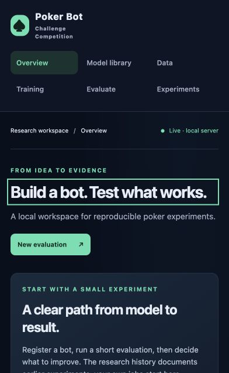
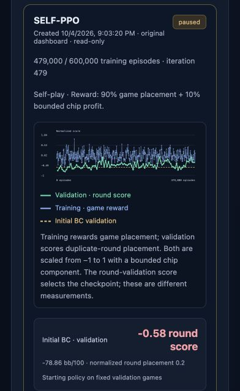
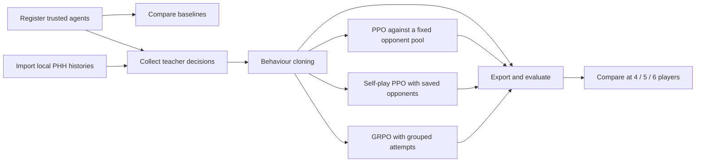

# Poker Bot Challenge Competition

A local research dashboard for collecting poker agents, learning from their
decisions, and comparing behaviour cloning, PPO, self-play PPO, and GRPO.

**Source-only portfolio:** no trained weights, collected bot implementations,
private datasets, or run databases are included. Small example agents let you
try the complete evaluation workflow immediately.

| Dashboard | Recorded SELF-PPO rewards |
| --- | --- |
|  |  |

These screenshots show the local dashboard and a real saved training run.
A fresh clone starts with an empty workspace. The reward screenshot comes from
the optional read-only history viewer; private training records and weights are
not included. A displayed training curve is not evidence of tournament strength.

## Start here

Use **Python 3.12**. From your cloned checkout:

```bash
python -m venv .venv
```

Activate it on macOS/Linux with `source .venv/bin/activate`, or on Windows
PowerShell with `.venv\Scripts\Activate.ps1`. Then, on every platform:

```bash
python -m pip install -r requirements.txt
python run.py --open-browser
```

Open **http://127.0.0.1:8765**. No Node.js, PyTorch, GPU, or large model download
is required for the dashboard and example games. The first install downloads the
official poker SDK and NumPy. [Full setup and GPU options](docs/SETUP.md).

1. Open **Model library** and upload the three `.py` files in `examples/`.
2. Select those agents, then open **Evaluate**.
3. Choose **Benchmark**, **10 hands**, and seed `demo-1`; queue the run.
4. Open **Experiments** to follow it, then inspect its completed leaderboard.

The four house opponents come with the SDK. The examples demonstrate the
interface; they are not competitive strategies. All data created while using
the app stays in your checkout's ignored `arena/data/` directory.

## Understand the workflow



These dashboard learning routes start from a completed compatible BC checkpoint;
saved jobs can resume their own checkpoints. Self-play is an opponent-generation
option within PPO, not a separate neural architecture.
The [pipeline guide](docs/PIPELINE.md) explains inputs, outputs, rewards,
evaluation, and how the branches differ.

The dashboard separates six tasks: **Overview**, **Model library**, **Data**,
**Training**, **Evaluate**, and **Experiments**. Advanced training settings stay
available without dominating the first-run workflow.

## What has been tried?

The published research snapshot is deliberately separate from jobs in a new
installation. As recorded on **11 October 2026**:

| Direction | Recorded progress |
| --- | --- |
| Existing agents | Collected and adapted multiple public strategies; original authors are credited separately. |
| Behaviour cloning | Two completed student-training jobs. Action agreement measures imitation, not poker winnings. |
| PPO | Completed fixed-pool and mixed-table experiments, plus paused follow-up runs. |
| Self-play PPO | Latest saved experiment: **SELF-PPO**, paused at **479,000 / 600,000 hands**, starting from BC_2, shared across 4/5/6-player tables. |
| GRPO | Implemented with tests; no main-workspace training run recorded. |
| Lookup and search | Historical standalone prototypes and frozen-PPO variants; source packages and generated tables are outside this dashboard release. |

Read [the experiment record](docs/EXPERIMENTS.md) for configurations, limitations,
and evidence. By default, the dashboard reads this curated snapshot from
`docs/experiments.json`. You can also explicitly connect your own saved training
history using `--live-ppo-data`; this reads the selected local database without
resuming its jobs or copying weights. See [viewing saved reward graphs](docs/SETUP.md#view-saved-ppo-reward-graphs).
No overall winner or tournament-strength claim is made.

## Training is optional

```bash
python -m pip install -r requirements-training.txt
```

For PHH import, also install `requirements-phh.txt` and select a local dataset
folder. No datasets are downloaded automatically. Linux/Windows users who want
CPU-only PyTorch should follow [the smaller CPU installation](docs/SETUP.md)
before installing training requirements.

Use CPU on any supported platform; Apple MPS and NVIDIA CUDA are optional and
depend on compatible hardware and PyTorch builds. Windows/macOS/Linux CI is
configured, but only locally executed checks are described as passed.

## Credits and scope

The [credits](docs/CREDITS.md) identify **17 collected policies**, their authors,
specific upstream implementations, pinned revisions where available, and local
adaptations. [model-sources.json](docs/model-sources.json) contains the same
provenance in a structured form. These are references, not bundled models.
SDK and dataset authors are credited there too. Exports preserve attribution,
license notices, and the registered source files.

## Project map

```text
arena/              Local server, poker evaluation, and learning workflows
  static/           Dashboard HTML, CSS, and JavaScript; no build step
  tests/            Temporary-data unit and integration tests
docs/               Setup, pipeline, experiment history, and credits
examples/           Small agents written for this release
scripts/            Portable smoke and browser checks
run.py              Cross-platform launch entry point
requirements*.txt   Separate core, training, and PHH dependencies
```

Run core tests with `python scripts/check.py`. With training and PHH dependencies
installed, run `python scripts/check.py --full`. Browser checks and CI details
are in [CONTRIBUTING.md](CONTRIBUTING.md).

The [validation record](docs/VALIDATION.md) reports the fresh installation,
287 passing tests, and completed browser workflow, with platform limits.

The server binds to localhost. Uploaded Python agents and checkpoints are
trusted local code, not sandboxed uploads: register only files you trust. This
is a local research app, not a public web service.
