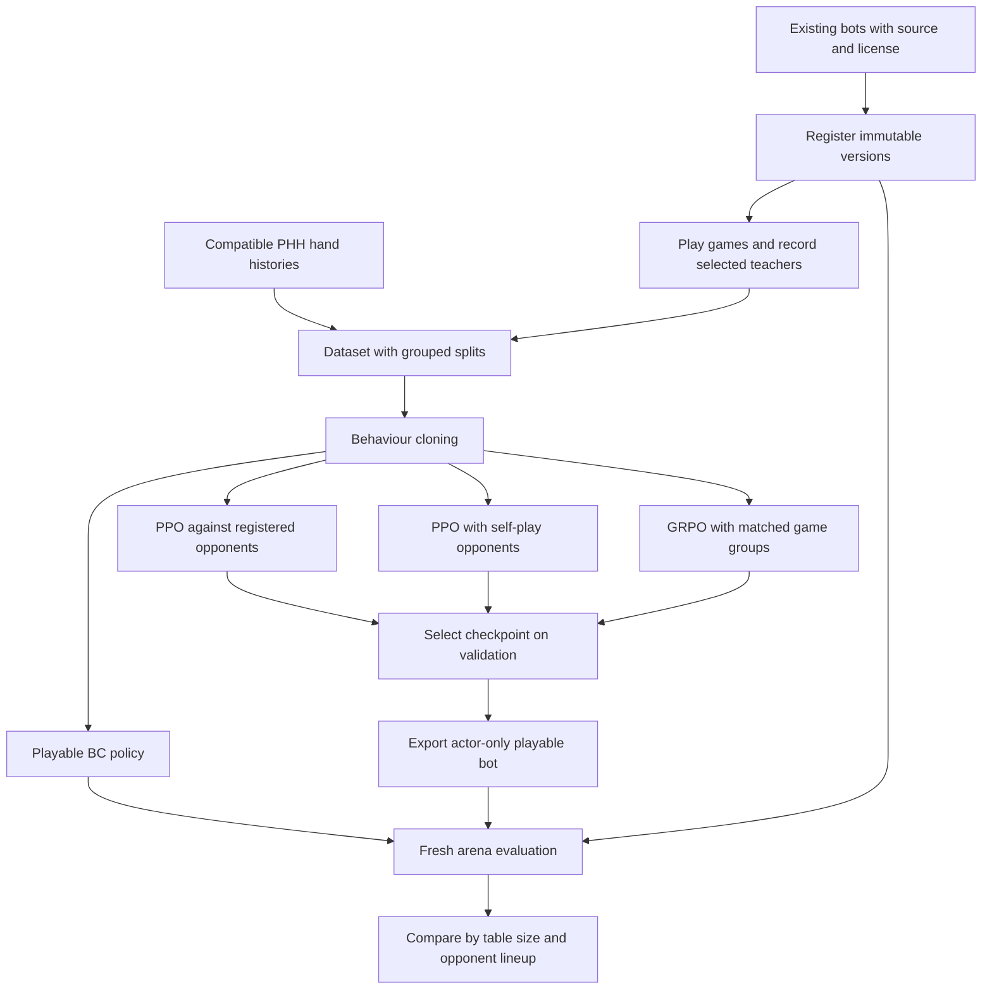

# From existing bots to a tested poker policy

The project has two connected workflows: **learn a policy** and **evaluate a playable bot**. You can evaluate an existing bot without training anything. PPO, self-play PPO and GRPO are alternative ways to improve a BC starting policy; they are not steps that must all run in order.

Every reference to a 4-, 5- or 6-player table counts **all players, including the learner**. One policy can accept all three table sizes. Training at only one size does not establish strength at the others.



## 1. Register existing models

Upload a trusted bot file or a ZIP containing `main.py` at its root. Registration snapshots its files and records a content hash. Give each revision a recognizable name; changing the original source does not change an already registered version.

The model library is a collection of strategies, not necessarily a collection of neural networks. Rule-based baselines, adapted public bots, BC students and trained PPO actors can all be opponents. Keep their upstream author, exact model or strategy, source URL, revision, license and modifications in the [credits](CREDITS.md). An adapter is our compatibility work; it does not make us the original strategy's author.

## 2. Collect demonstrations or import histories

For generated data, select the participants, then select which participants are teachers. All participants play; only teachers supply training labels. The recorder saves each teacher's legal observation immediately before its action, plus the requested and engine-executed actions. BC uses the executed action. A teacher with a failed game verdict contributes no demonstrations from that game.

For historical data, PHH import replays compatible no-limit Hold'em hands and skips unsupported or incomplete records with a reason. The dashboard importer requires 4–6 players, standard blinds, no antes and 100 BB starting stacks. Inspect the import report: scanning a collection does not mean every record was usable. A filter for profitable hands is optional and can remove strategically correct losing decisions, including folds.

Both routes produce the same kind of decision dataset. An observation includes the actor's own cards and information already public at that moment. Other players' hidden cards and future community cards must never be input features. Spectator replays are for inspection; they are not a substitute for correctly recorded training observations.

**Keep whole seed groups or source sessions together when splitting data.** Duplicate deals, seat rotations and decisions from the same hand are related. Splitting individual rows randomly can leak the same scenario into training and evaluation.

## 3. Learn a starting policy with BC

Behaviour cloning asks: “Which action would these teachers take here?” The student learns action labels from completed datasets. The baseline encoder has 189 features, hidden layers of 128 and 64 units, and seven action classes:

| Action class | Meaning |
| --- | --- |
| Fold | Leave the hand |
| Check/call | Check when free, otherwise match the bet |
| Minimum raise | Smallest legal raise |
| Half-pot raise | Raise using the shared half-pot size convention |
| Pot raise | Raise using the shared pot-size convention |
| Double-pot raise | Raise using the shared double-pot convention |
| All-in | Commit the remaining stack |

The shared encoder removes illegal and duplicate choices. Historical raise sizes are approximated by this action set; inspect the recorded approximation error. The best validation loss chooses the checkpoint; held-out action agreement is reported separately. High agreement means good imitation, not a high win rate.

## 4. Choose one reinforcement-learning experiment

All three dashboard routes below start from a **completed compatible BC checkpoint**. The source and fixed benchmark opponents are copied when the job is created. They do not overwrite the BC model. The forms do not accept every arbitrary pretrained checkpoint.

| Method | Where new experience comes from | How it learns | What to watch |
| --- | --- | --- | --- |
| PPO: existing bots | New games against frozen registered opponents | Actor and critic updates from collected rewards | Fixed validation, KL, entropy, opponent dependence |
| PPO: self-play | Frozen copies of the current actor, refreshed after an update | The same PPO learner; only its designated seat supplies training decisions | External validation, not self-play profit alone |
| PPO: mixed self-play | Per opponent seat: 50% current, 25% historical, 25% registered bot | PPO with a changing training opponent pool | Historical pool and actual sampled seat counts |
| GRPO | Repeated matched 100-hand games; only learner sampling changes within a group | Compare each game's reward to its group, then update the actor without a critic | Reward spread, groups with no learning signal, fixed validation |

Self-play copies have separate private observations and random state. They share frozen policy weights, not hidden cards. There is one learner and optimizer, rather than a different learned model for every seat or table size. Mixed mode's historical share uses the current policy until an older snapshot exists.

GRPO's default four attempts use 400 hand episodes per group. Keep episode targets, rollouts and milestone intervals divisible by the group size times 100. Groups with no reward variation do not update the policy. GRPO here is an experimental adaptation for poker, not a claim that it outperforms PPO.

### Reward and budget mean different things

Legacy PPO jobs use net hand profit in big blinds. Placement-mode PPO and GRPO use completed 100-hand games and default to:

```text
game_reward = 0.90 * normalized_game_placement
            + 0.10 * tanh(game_bb_per_100 / 100)
```

Normalized placement maps last to −1 and first to +1, averaging tied positions. This is a training proxy for competition scoring. Validation selects on complete duplicate-round placement with the bounded chip component. It does not train the complete tournament regrouping process.

Placement policies add seven public game-context features: hand progress and relative-seat cumulative scores from completed hands. Their 196-feature export includes this context code. Old 189-feature policies retain their original encoding and reward when resumed.

**One episode is one completed table hand.** It is not one decision, one whole tournament or one independent sample. Evaluation hands are additional to the training budget. A 1,000-hand placement rollout contains ten game outcomes. Training budget alone says nothing about the size of an improvement.

## 5. Select, export and evaluate

Fixed validation chooses the best saved policy; the starting BC policy may remain best at iteration zero. The latest checkpoint is for resume and may differ from the best checkpoint. Final held-out tests happen after training; repeatedly choosing settings using those tests makes them validation data.

Playable exports contain the actor and inference code, without the training critic or optimizer. PyTorch is not needed during play. Register the export as another version, then compare it with unchanged baselines on fresh seeds. The dashboard's common work queue serializes evaluation, dataset collection and training jobs.

| Evaluation mode | Main purpose |
| --- | --- |
| Benchmark | Check candidates against the same house opponents |
| Table-size study | Compare mixed lineups with results separated at 4/5/6 total players |
| Tournament | Run the local four-round placement-based format |

Use the same candidate artifact for all table sizes. Match seeds, hand counts, opponents and seat rotations when comparing methods. Report failures, coverage and decision time alongside results. A short smoke run establishes compatibility; it does not identify a winning strategy. Duplicate-deal hands are correlated, so any uncertainty estimate must respect seed/deal groups rather than treat every action as an independent sample.

## Separate development experiments: lookup and search

These historical standalone prototypes are documented in [the experiment record](EXPERIMENTS.md). Their weights, generated lookup data and source packages are **not included in this dashboard source release**.

```text
offline PHH observations -> action-frequency lookup table

frozen PPO -> optional small lookup blend -> sample baseline action
           -> optional simulated continuations -> keep or replace action
```

Lookup replaces repeated offline calculation with a table read. The existing prototypes store demonstrated action frequencies, not optimal action values. Rollouts simulate the rest of a hand to estimate an action's result. That use of “rollout” differs from the training batches of newly played hands called rollouts in PPO.

The four frozen variants were PPO alone, PPO + lookup, PPO + rollouts and PPO + lookup + rollouts. They keep the same neural weights; only the decision procedure changes. Search at play time does not itself retrain PPO. A future experiment could train from search-improved targets, but that is a different training method and is not claimed here.

## Where to read the implementation

| Responsibility | Source files |
| --- | --- |
| Registration, queue and API | `arena/server.py`, `arena/manage.py` |
| Games and observation recording | `arena/game_worker.py`, `arena/recording.py` |
| Dataset collection and PHH import | `arena/datasets.py`, `arena/phh.py`, `arena/phh_jobs.py` |
| Features, labels and BC | `arena/bc_features.py`, `arena/cloning.py`, `arena/bc_train_worker.py` |
| PPO and self-play | `arena/ppo.py`, `arena/ppo_train_worker.py`, `arena/ppo_rollout.py`, `arena/ppo_selfplay.py` |
| GRPO | `arena/grpo.py`, `arena/grpo_train_worker.py`, `arena/grpo_rollout.py` |
| Reward, public context and milestones | `arena/ppo_objectives.py`, `arena/ppo_context.py`, `arena/ppo_milestones.py` |
| Evaluation and packaging | `arena/study.py`, `arena/scoring.py`, `arena/export.py` |

See [EXPERIMENTS.md](EXPERIMENTS.md) for what was actually attempted, and the project [README](../README.md) for installation and first use.
